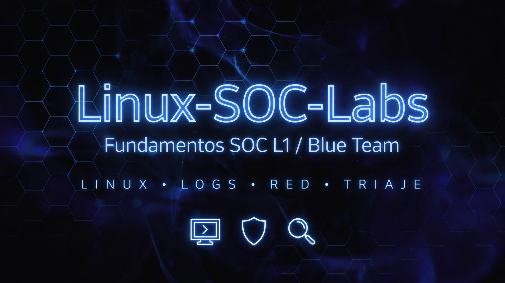

# Linux-SOC-Labs - Portafolio SOC L1 (Blue Team)

Este repo es donde partí en SOC. Todo lo hice en **Kali Linux** en VirtualBox, con Bash y logs reales de laboratorio. Es la base que después me permitió operar en [](https://github.com/gutierrezsebasg/Kali-Purple-SOC-Ops).

<p align="center">
  <a href="#m1-2"></a>
  <a href="#m3"></a>
  <a href="#m4"></a>
  <a href="#m5"></a>
  <a href="#m6"></a>
  <a href="#m7"></a>
  <a href="#m8"></a>
  <a href="#m9"></a>
  <a href="#m10"></a>
</p>

<p align="center">
  
  
  
  
</p>


<a id="m1-2"></a>
## Módulo 1 y 2: Fundamentos de Terminal y Archivos [Completado]

<details open>
<summary><b>Objetivo: Dejé mi terminal operativa - navegación, archivos y permisos para investigar en Linux</b></summary>

### 1. Entorno de Trabajo y Herramientas
- **Sistema Operativo:** Kali Linux (VirtualBox)
- **Lenguaje:** Bash Shell Scripting

### 2. Comandos Practicados

**2.1 Ubicación y Navegación**
```bash
pwd          # Ruta del directorio actual
ls -la       # Listado con ocultos y permisos
cd /var/log  # Navegación a logs
```

**2.2 Inspección de Archivos y Eventos**
```bash
cat auth.log  # Visualización de logs en terminal
```

**2.3 Aplicación SOC**
- Exploré estructura de archivos en sistema comprometido
- Identifiqué `Failed password` y conexiones sospechosas
- Dejé la base para investigar fuerza bruta

### Resultado
**Terminal lista.** Sin esto no hay triage. Dejé la navegación y permisos dominados para pasar a logs y red.

</details>


<a id="m3"></a>
## Módulo 3: Monitoreo de SSH, Gestión de Servicios y Puertos [Completado]

<details>
<summary><b>Objetivo: Dejé mi monitoreo SSH listo - detecté 3 intentos con hacker_falso y validé puerto 22 con ss</b></summary>

### Descripción General
Revisé puertos abiertos, conexiones activas y supervisión en vivo del servicio SSH. Automatización con `monitor_ssh.sh`.

### Comandos y Herramientas Utilizadas
```bash
ss -tulanp                          # Verifica puertos en escucha, confirma 22/tcp para sshd
ssh hacker_falso@127.0.0.1           # Genera intentos fallidos para la prueba
sudo journalctl -u ssh -f            # Monitoreo en vivo del servicio SSH
sudo journalctl -u ssh -n 15         # Últimas 15 líneas - usado en la captura
chmod 600 ~/.ssh/id_rsa              # Permisos estrictos para llave privada
```

### Evidencia de Análisis
<p align="center">
  
</p>

> **Validación:** Captura con `journalctl -u ssh -n 15` tras 3 intentos con `hacker_falso`. Se ven `Invalid user`, `pam_unix(sshd:auth): check pass; user unknown` y `authentication failure`. Detección de fuerza bruta confirmada.

### Resultado
**Monitoreo SSH operativo.** Dejé el servicio auditado y la evidencia lista para correlacionar en M9.

</details>


<a id="m4"></a>
## Módulo 4: Captura y Análisis de Tráfico de Red (`captura_red.sh`) [Completado]

<details>
<summary><b>Objetivo: Dejé mi captura lista - capturé 20 paquetes con tcpdump y los analicé en Wireshark</b></summary>

### Objetivo
Capturar tráfico en vivo, exportar a `.pcap` e inspeccionar protocolos y capas OSI para análisis SOC.

### Herramientas
- **tcpdump**: Captura CLI en tiempo real
- **Wireshark**: Inspección profunda

### Procedimiento
```bash
ip a                                              # Identifica interfaz eth0 e IP (10.0.2.15)
sudo tcpdump -i eth0 -c 20 -w red_laboratorio.pcap   # Captura 20 paquetes
```

1. Identificación de interfaz `eth0` con `ip a`
2. Captura en vivo de 20 paquetes
3. Exportación a `red_laboratorio.pcap`
4. Inspección OSI (L3 IP, L4 TCP/UDP) y filtros `icmp`, `dns`
5. Automatización con script `captura_red.sh`

### Evidencia de Análisis
<p align="center">
  
</p>

> **Validación:** 20 paquetes capturados con `tcpdump` y analizados en Wireshark.

### Resultado
**Captura de red validada.** Dejé el flujo `ip a` -> `tcpdump` -> `.pcap` -> Wireshark operativo.

</details>


<a id="m5"></a>
## Módulo 5: SIEM (Splunk), Análisis de Logs y Triaje [Completado]

<details>
<summary><b>Objetivo: Dejé mi triaje en SIEM listo - filtré Top IPs y detecté Accepted de IP sospechosa 10.0.0.55</b></summary>

### Objetivo
Investigación con filtros en Linux y consultas SPL en Splunk para triaje y contención inicial.

### Consultas Integradas

**Linux (Procesamiento de Logs)**
```bash
# Top IPs con intentos de acceso
cat access.log | awk '{print $1}' | sort | uniq -c | sort -nr | head -n 10

# Login exitoso de IP sospechosa
grep "10.0.0.55" /var/log/auth.log | grep -i "Accepted"
```

**Splunk (SPL)**
```spl
index=main sourcetype=syslog "Failed password" | stats count by src_ip | sort -count
index=main src_ip="10.0.0.55" "Accepted password"
```

### Playbook de Contención
```bash
sudo iptables -A INPUT -s IP_ATACANTE -j DROP  # Bloqueo firewall
sudo ip link set dev eth0 down                 # Aislamiento de red
sudo passwd -l usuario                         # Congelar cuenta
sudo pkill -u usuario                          # Terminar sesiones
```

### Resultado
**Triage en SIEM operativo.** Dejé la lógica Linux + SPL y el playbook de contención listo para aplicar en M9.

</details>


<a id="m6"></a>
## Módulo 6: Inspección de Tráfico con tcpdump y Wireshark [Completado]

<details>
<summary><b>Objetivo: Dejé mi inspección .pcap lista - detecté HTTP en claro con credenciales en puerto 80</b></summary>

### Objetivo
Analizar `.pcap` para detectar tráfico no cifrado y posible exfiltración de credenciales.

### Captura en Consola
```bash
sudo tcpdump -i eth0 -w captura.pcap   # Captura tráfico de eth0 y guarda evidencia en .pcap
sudo tcpdump -r captura.pcap           # Lee e inspecciona el .pcap en terminal sin Wireshark
```

### Filtros Clave Wireshark
```bash
ip.addr == 192.168.1.105               # Tráfico completo de IP sospechosa (origen/destino)
http                                   # Peticiones HTTP en texto plano (puerto 80)
http.request.method == "POST"          # Busca envíos de formularios / credenciales
dns                                    # Consultas de nombres de dominio
```

> **Validación:** Tráfico HTTP en puerto 80 expone usuario/contraseña en texto plano. Refuerza necesidad de TLS/HTTPS (443).

### Resultado
**Inspección .pcap validada.** Dejé los filtros clave de Wireshark y la conclusión sobre HTTP en claro.

</details>


<a id="m7"></a>
## Módulo 7: Análisis de Malware e IoCs [Completado]

<details>
<summary><b>Objetivo: Dejé mi flujo de malware listo - clasifiqué 5 familias y extraje IoCs con hash SHA-256</b></summary>

### Descripción General
Clasificación de malware y procedimiento SOC para identificación y extracción de evidencias.

### 1. Clasificación de Amenazas
- **Ransomware:** Cifrado con fines de extorsión
- **InfoStealer / Spyware:** Robo de credenciales y tokens
- **Trojan:** Código malicioso en ejecutable legítimo aparente
- **Worm:** Propagación autónoma por red
- **Rootkit:** Ocultamiento a nivel kernel para evadir AV/EDR

### 2. Indicadores de Compromiso (IoCs)
| Tipo de IoC | Ejemplo / Formato | Uso en el SOC |
| :--- | :--- | :--- |
| **Archivo** | SHA-256, MD5 | Identificación en VirusTotal / EDR |
| **Red (C2)** | IP, Dominio, URL | Bloqueo en Firewall, Proxy, DNS Sinkhole |
| **Host** | %APPDATA%, Clave Run | Aislamiento y reglas de detección |

### 3. Flujo Operativo de Triaje
```bash
# Extracción de hash
Get-FileHash -Algorithm SHA256 .\archivo.exe   # PowerShell
sha256sum archivo.exe                           # Linux
```
1. Extracción de hash
2. Análisis estático en VirusTotal
3. Análisis dinámico en sandbox (ANY.RUN, Hybrid Analysis)
4. Contención y bloqueo en EDR

### Resultado
**Flujo de malware documentado.** Dejé la clasificación, tabla de IoCs y flujo de triaje con hash.

</details>


<a id="m8"></a>
## Módulo 8: Análisis de Phishing e Investigación de Headers [Completado]

<details>
<summary><b>Objetivo: Dejé mi flujo de phishing listo - validé SPF/DKIM/DMARC y contención por VP</b></summary>

### 1. Capas de Inspección
- **Cabecera:** Metadatos y enrutamiento, valida IP origen y autenticación
- **Cuerpo y URLs:** Ingeniería social y credential harvesting
- **Adjuntos:** Payloads maliciosos (exe, macro, zip)

### 2. Validación de Autenticación
| Mecanismo | Función | Criterio de Verificación |
| :--- | :--- | :--- |
| **SPF** | IPs autorizadas para enviar por dominio | FAIL = IP no autorizada |
| **DKIM** | Firma criptográfica de integridad | FAIL = mensaje alterado |
| **DMARC** | Política para fallos SPF/DKIM | reject / quarantine / none |

### 3. Flujo Operativo
1. Recepción de ticket (.eml/.msg)
2. Análisis de headers (Google Toolbox, MXToolbox)
3. Inspección segura de URLs (URLScan.io, VirusTotal)
4. Hash de adjuntos (SHA-256) y reputación

### 4. Contención (Verdadero Positivo)
- Bloqueo perimetral de dominio, IP y URLs
- Purga de buzones en M365
- Notificación y cierre de ticket

### Resultado
**Phishing documentado.** Dejé el flujo de headers, validación SPF/DKIM/DMARC y playbook de contención VP.

</details>


<a id="m9"></a>
## Módulo 9: Auditoría y Detección de Fuerza Bruta SSH [Completado]

<details>
<summary><b>Objetivo: Dejé mi auditoría SSH lista - detecté 192.168.1.105 con 3 intentos y lo dejé como IoC</b></summary>

### Descripción
Análisis de `~/analisis_ataque.log` (simulación de `/var/log/auth.log`) para detectar fuerza bruta SSH, aislar IoCs e IPs sospechosas.

### Metodología
```bash
cat ~/analisis_ataque.log
grep "Failed password" ~/analisis_ataque.log | awk '{print $11}' | sort | uniq -c | sort -nr
```

1. **Filtrado:** Identificar `Failed password`
2. **Aislamiento:** Extraer IP origen con `awk '{print $11}'`
3. **Consolidación:** Agrupar, contar y rankear IPs con `sort | uniq -c | sort -nr`

### Resultado
Identificación de IP `192.168.1.105` con 3 intentos en intervalo corto, patrón de fuerza bruta confirmado. En entorno real sería `/var/log/auth.log` con `$(NF-3)`.

### Evidencia
<p align="center">
  
</p>

> **Validación:** Top IPs atacantes: 192.168.1.105 (3) y 10.0.0.50 (1).

### Aplicación SOC L1
- Generación de IoCs
- Bloqueo preventivo en firewall
- Creación de reglas de correlación para SIEM

### Resultado
**Auditoría SSH cerrada.** Este flujo es la base de mi M5 SOAR en Kali Purple.

</details>


<a id="m10"></a>
## Módulo 10: Automatización Defensiva, Triaje y Cierre de Fundamentos [Completado]

<details>
<summary><b>Objetivo: Dejé mis fundamentos cerrados - triaje VP/FP y matriz de severidad listos para Kali Purple</b></summary>

### 1. Introducción
Cierre de fundamentos Linux, Redes y Análisis de Tráfico (Módulos 1-9). Puente hacia operación defensiva avanzada.

### 2. Síntesis del Aprendizaje

**Navegación y Administración (Módulos 1-3)**
Terminal Linux, sistema de archivos, permisos y procesos.

**Análisis de Registros (Módulos 4-6)**
Inspección de `/var/log/syslog`, `/var/log/auth.log` con `cat`, `grep`, `awk`, `sed`.

**Redes e Inspección (Módulos 7-9)**
TCP/IP, análisis `.pcap` con Wireshark y Tshark para IoCs.

### 3. Flujo de Triaje L1
1. **Ingreso:** Alerta de colector de logs / IDS
2. **Parsing y Enriquecimiento:** IP origen/destino, puerto, hash, usuario
3. **Análisis de Contexto:** Validación rápida
4. **Dictamen:**
   - **Verdadero Positivo (VP):** Malicioso confirmado
   - **Falso Positivo (FP):** Legítimo, documentar y tunear regla

### 4. Matriz de Severidad
| Nivel | Descripción | Acción Recomendada |
| :--- | :--- | :--- |
| **Bajo (Low)** | Escaneos bloqueados, eventos informativos | Monitoreo pasivo |
| **Medio (Medium)** | Múltiples login fallidos, tráfico en puertos raros | Revisar /var/log/ y correlacionar IP |
| **Alto (High)** | Conexión a IP C2, comandos sospechosos | Triaje prioritario, extraer .pcap y contener |
| **Crítico (Critical)** | Movimiento lateral, exfiltración, root no autorizado | Escalar a L2 / IR inmediato |

### 5. Transición a Fase Operativa
Base Linux/Redes documentada. Siguiente fase en suite especializada **Kali Purple**.

**Repositorio Operativo:** https://github.com/gutierrezsebasg/Kali-Purple-SOC-Ops

### Resultado
**Fundamentos cerrados.** Dejé el flujo VP/FP y la matriz de severidad que uso en Kali Purple M4-M6. Juntos demuestran progresión L1: de comando a incidente.

</details>


